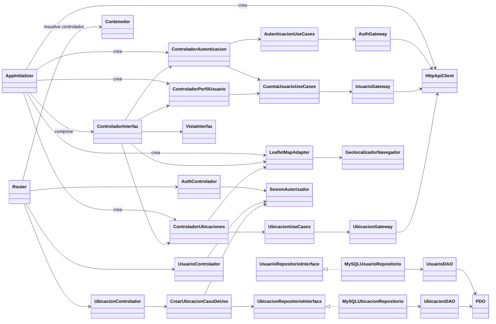

# 01. Recorrido y arquitectura

## 1. De la petición HTTP a la landing page

1. El `.htaccess` de la raíz impide listar directorios, bloquea el acceso web a `.env`, `.git`, `core`, `src` y `storage`, y reescribe las solicitudes hacia `public/` ([reglas de raíz](../.htaccess#L1-L15)).
2. `public/.htaccess` dirige las rutas virtuales que no son archivos/directorios a `public/index.php` ([front controller de Apache](../public/.htaccess#L20-L30)). También define cabeceras defensivas de respuesta ([cabeceras](../public/.htaccess#L36-L41)).
3. `public/index.php` configura zona horaria y registro de errores, carga el autoloader y `.env`, configura CORS, responde a `OPTIONS`, ejecuta rate limiting, registra dependencias/rutas y despacha las solicitudes ([inicialización PHP](../public/index.php#L6-L18), [autoload y configuración](../public/index.php#L35-L75), [rate limit y módulos](../public/index.php#L78-L123), [landing y despacho](../public/index.php#L126-L147)).
4. Una petición `GET /` o `GET /index.php` sirve `public/index.html`; las demás rutas llegan al `Router` ([selección landing/API](../public/index.php#L126-L140)).
5. El HTML carga Leaflet 1.9.4 desde unpkg, referencias a componentes HTML y `js/AppInitializer.js` ([recursos y componentes](../public/index.html#L27-L43)).

## 2. Arranque del frontend

En `DOMContentLoaded`, el inicializador:

- carga en paralelo todos los marcadores `data-componente`; si alguno falla, registra el problema, muestra una alerta y detiene el arranque ([AppInitializer.js](../public/js/AppInitializer.js#L22-L33), [CargadorComponentes.js](../public/js/Presentacion/Componentes/CargadorComponentes.js#L7-L30));
- calcula la ruta base de API a partir de la URL actual y construye `HttpApiClient` ([base API](../public/js/AppInitializer.js#L35-L36));
- compone los casos de uso con gateways, instancia las vistas, registra componentes UI, mapa, geolocalizador y controladores ([composición](../public/js/AppInitializer.js#L37-L65));
- inicializa la aplicación, procesa enlaces con tokens y finalmente consulta el estado de sesión ([orden final](../public/js/AppInitializer.js#L66-L69)).

La página se compone con los fragmentos de navegación, alerta, mapa, panel de cuenta y modales ([index.html](../public/index.html#L34-L40)). El cargador transforma cada fragmento en un `<template>` y reemplaza el marcador correspondiente ([CargadorComponentes.js](../public/js/Presentacion/Componentes/CargadorComponentes.js#L12-L29)).

### Capas del frontend

| Capa | Responsabilidad | Archivos representativos |
|---|---|---|
| Presentación / vistas | Conecta eventos DOM, muestra formularios/alertas y dibuja datos. | [VistaInterfaz](../public/js/Presentacion/Shared/VistaInterfaz.js#L3), [ControladorAutenticacion](../public/js/Presentacion/Autenticacion/ControladorAutenticacion.js#L1), [ControladorUbicaciones](../public/js/Presentacion/Ubicaciones/ControladorUbicaciones.js#L1) |
| Aplicación | Orquesta tareas y normaliza entradas antes de delegar. | [CuentaUsuarioUseCases](../public/js/Aplicacion/Usuarios/CuentaUsuarioUseCases.js#L1), [UbicacionUseCases](../public/js/Aplicacion/Ubicaciones/UbicacionUseCases.js#L3) |
| Dominio | Reglas de tipos y coordenadas del cliente. | [Coordenadas](../public/js/Dominio/Ubicaciones/Coordenadas.js#L1) |
| Infraestructura | HTTP, endpoints, mapa Leaflet y geolocalización del navegador. | [HttpApiClient](../public/js/Infraestructura/Http/HttpApiClient.js#L1), [LeafletMapAdapter](../public/js/Infraestructura/Map/LeafletMapAdapter.js#L3) |

`HttpApiClient` usa `fetch`, envía credenciales same-origin, decodifica JSON y lanza error ante respuestas HTTP no exitosas ([request](../public/js/Infraestructura/Http/HttpApiClient.js#L6-L28)). Los gateways definen endpoint y forma del cuerpo; por ejemplo, [AuthGateway](../public/js/Infraestructura/Api/AuthGateway.js#L6) y [UbicacionGateway](../public/js/Infraestructura/Api/UbicacionGateway.js#L6). Para `FormData`, el cliente no fuerza manualmente el `Content-Type`, dejando que el navegador agregue el boundary ([POST](../public/js/Infraestructura/Http/HttpApiClient.js#L37-L49)).

## 3. Restauración de sesión y vistas

`ControladorInterfaz` conecta los controladores y el adaptador de mapa, inicializa eventos y pasa los clics del mapa al controlador de ubicaciones ([wiring e inicialización](../public/js/ControladorInterfaz.js#L1-L36)). La restauración llama `verificarSesion`; si la API falla, registra el error y vuelve a estado no autenticado. Al cambiar sesión, actualiza la interfaz y solicita datos del mapa ([restauración y cambio de sesión](../public/js/ControladorInterfaz.js#L38-L58)).

`ControladorUbicaciones.cargarParaUsuario` siempre obtiene las ubicaciones públicas y la geocerca; con sesión obtiene además las propias y dibuja la vista privada; sin sesión dibuja la pública ([carga de ubicaciones](../public/js/Presentacion/Ubicaciones/ControladorUbicaciones.js#L23-L36)).

## 4. Mapa

- `LeafletMapAdapter.inicializar` crea el mapa, limita inicialmente la vista regional, añade tiles de OpenStreetMap y escucha clics. El evento entrega latitud/longitud redondeadas a seis decimales ([mapa y clic](../public/js/Infraestructura/Map/LeafletMapAdapter.js#L27-L52)).
- `actualizarGeocerca` dibuja el círculo y ajusta límites en modo circular o aplica límites y centro de Colombia en modo nacional ([geocerca visual](../public/js/Infraestructura/Map/LeafletMapAdapter.js#L54-L86)).
- Las ubicaciones públicas muestran autor; las privadas ofrecen controles de eliminación según el popup creado ([vistas y marcadores](../public/js/Infraestructura/Map/LeafletMapAdapter.js#L88-L125), [popup](../public/js/Presentacion/Ubicaciones/VistaPopupUbicacion.js#L4-L42)).
- El botón GPS usa `navigator.geolocation.getCurrentPosition`, pide alta precisión, fija timeout de 10 segundos y redondea coordenadas a seis decimales ([GeolocalizadorNavegador](../public/js/Infraestructura/Map/GeolocalizadorNavegador.js#L6-L35)).

La geocerca visual orienta la navegación; la decisión final sobre la coordenada se valida en el backend y no depende del mapa del navegador ([reglas geográficas del backend](./03-api-reglas-persistencia.md#reglas-de-ubicaciones)).

## 5. Componentes e interfaz

`BotonUI`, `ContenedorUI` y `ModalUI` encapsulan elementos HTML nativos; los componentes se registran evitando registrar nombres ya existentes ([registro](../public/js/Presentacion/Componentes/RegistrarComponentesUI.js#L1-L16)). `VistaInterfaz` enlaza clics/formularios, evita el submit nativo, deshabilita el submit durante el trabajo, captura errores, manipula modales y muestra alertas ([eventos y formularios](../public/js/Presentacion/Shared/VistaInterfaz.js#L9-L60), [modales/alertas](../public/js/Presentacion/Shared/VistaInterfaz.js#L64-L122)).

El dashboard cambia sus opciones según rol ([ConstructorDashboard](../public/js/Presentacion/Shared/ConstructorDashboard.js#L8-L49)). Los textos se centralizan en [textos-es.js](../public/js/textos-es.js#L1-L43); el aplicador usa atributos `data-texto`, `data-aria-texto` y `data-titulo-texto` ([AplicadorTextos](../public/js/Presentacion/Shared/AplicadorTextos.js#L8-L29)). El tema claro/oscuro/sistema se guarda en `localStorage`; la implementación cae a tema sistema si no puede leer/escribir almacenamiento ([GestorTema](../public/js/Presentacion/Shared/GestorTema.js#L1-L73)). Los colores están en [tema claro](../public/css/tema-claro.css#L1) y [tema oscuro](../public/css/tema-oscuro.css#L1); [estructura-general.css](../public/css/estructura-general.css#L1) define estructura, controles, paneles, mapa y responsive.

## 6. Capas del backend

`public/index.php` es el punto PHP de composición. El autoloader resuelve `Core\` desde `core/` y los demás namespaces desde `src/` ([autoload](../public/index.php#L35-L50)).

| Capa | Responsabilidad | Ejemplos |
|---|---|---|
| HTTP / módulos | Registra rutas y traduce HTTP a entradas del caso de uso. | [AuthModulo](../src/AuthFuncionalidad/AuthModulo.php#L34), [UsuariosModulo](../src/UsuariosFuncionalidad/UsuariosModulo.php#L48), [UbicacionesModulo](../src/UbicacionesFuncionalidad/UbicacionesModulo.php#L24) |
| Aplicación | Ejecuta operaciones de negocio con autorización, reglas y transacciones. | [CrearUbicacionCasoDeUso](../src/UbicacionesFuncionalidad/Aplicacion/CasosDeUso/CrearUbicacionCasoDeUso.php#L24), [RegistrarUsuarioCasoDeUso](../src/UsuariosFuncionalidad/Aplicacion/CasosDeUso/RegistrarUsuarioCasoDeUso.php#L38) |
| Dominio | Entidades, invariantes, excepciones, roles e interfaces. | [UbicacionEntidad](../src/UbicacionesFuncionalidad/Dominio/Entidades/UbicacionEntidad.php#L1), [RolUsuario](../src/Shared/Dominio/Seguridad/RolUsuario.php#L8) |
| Infraestructura | PDO, DAOs, repositorios, sesión, SMTP, logs y catálogo. | [MySQLUbicacionRepositorio](../src/UbicacionesFuncionalidad/Infraestructura/Repositorios/MySQLUbicacionRepositorio.php#L1), [SesionAutorizador](../src/Shared/Infraestructura/Seguridad/SesionAutorizador.php#L14) |

El `Router` normaliza método y ruta, busca coincidencia exacta y pide al contenedor la instancia del controlador; una ruta no reconocida produce 404 JSON ([Router](../core/Router.php#L27-L97)). `Contenedor` resuelve bindings y parámetros tipados mediante Reflection y conserva instancias durante la petición ([Contenedor](../core/Contenedor.php#L10-L100)). Los módulos registran implementaciones de interfaces (repositorios, sesión, correo, transacciones) para que el autowiring conecte controladores y casos de uso ([SharedModulo](../src/Shared/SharedModulo.php#L20-L62), [UsuariosModulo](../src/UsuariosFuncionalidad/UsuariosModulo.php#L20-L45), [UbicacionesModulo](../src/UbicacionesFuncionalidad/UbicacionesModulo.php#L15-L24)).

## 7. Diagrama de clases (Mermaid)

El diagrama es una vista de las dependencias principales, no una lista exhaustiva de todas las clases. Los tres gateways y controladores de dominio se instancian en el inicializador; en PHP el `Router` obtiene controladores desde el contenedor. Los enlaces a cada clase y los puntos de composición están en la tabla de capas y las referencias anteriores.
