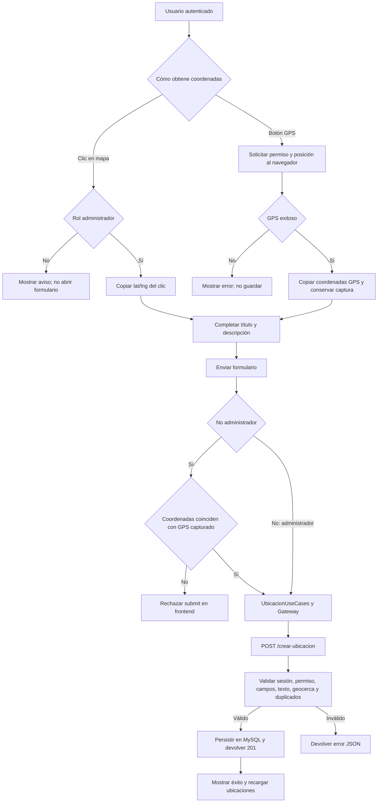
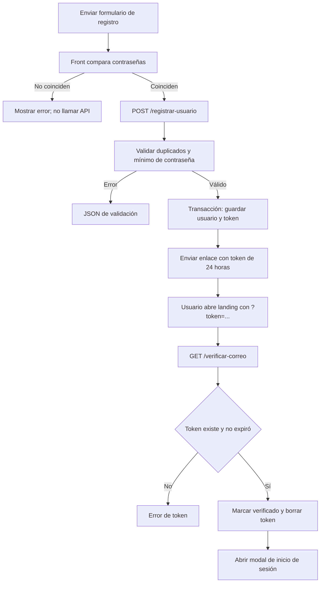

# 02. Acciones y flujos de usuario

## 1. Inicio, visitante y sesión

Al llegar a la landing:

1. El navegador inserta componentes HTML y configura los controladores.
2. Se inicializan los eventos, el mapa y la sesión.
3. `GET /verificar-sesion` devuelve el estado. Un visitante recibe `autenticado: false`; la vista muestra acciones de invitado y ubicaciones públicas. Un usuario con sesión ve sus datos y ubicaciones privadas, además del mapa público como consulta inicial.

Referencias: [index.html](../public/index.html#L34-L43), [AppInitializer.js](../public/js/AppInitializer.js#L22-L69), [restauración](../public/js/ControladorInterfaz.js#L38-L58), [endpoint](../src/AuthFuncionalidad/AuthModulo.php#L34-L39), [verificar sesión](../src/AuthFuncionalidad/Http/AuthControlador.php#L95-L124).

## 2. Iniciar/cerrar sesión

- **Iniciar sesión:** el botón abre el modal, el submit llama al controlador, se envían correo y contraseña como `FormData` a `POST /login`. Con éxito se actualiza la sesión local, se cierra el modal, se refrescan las ubicaciones y se muestra mensaje ([HTML](../public/componentes/modales-autenticacion.html#L1-L21), [controlador](../public/js/Presentacion/Autenticacion/ControladorAutenticacion.js#L13-L64), [gateway](../public/js/Infraestructura/Api/AuthGateway.js#L6-L19)).
- **Cerrar sesión:** el panel llama a `POST /logout`; tras éxito se borra el estado local y se renderiza como visitante ([ControladorPerfilUsuario](../public/js/Presentacion/Usuarios/ControladorPerfilUsuario.js#L78-L88), [AuthGateway](../public/js/Infraestructura/Api/AuthGateway.js#L13-L19)).
- El backend verifica credenciales, exige correo verificado, regenera el ID de sesión y devuelve campos públicos del usuario ([LoginCasoDeUso](../src/AuthFuncionalidad/Aplicacion/CasosDeUso/LoginCasoDeUso.php#L29-L75), [sesión PHP](../src/Shared/Infraestructura/Servicios/NativaPhpSesionUsuario.php#L11-L61)).

## 3. Registro y verificación de correo

El formulario recoge apodo, correo, contraseña y confirmación; HTML exige los campos y mínimo ocho caracteres para ambas contraseñas ([formulario](../public/componentes/modales-autenticacion.html#L23-L53)). El caso de uso JavaScript comprueba coincidencia y recorta apodo/correo ([CuentaUsuarioUseCases](../public/js/Aplicacion/Usuarios/CuentaUsuarioUseCases.js#L6-L12)). El backend valida duplicados de apodo/correo, longitud mínima de contraseña, guarda hash con `PASSWORD_DEFAULT` y deja la cuenta sin verificar ([RegistrarUsuarioCasoDeUso](../src/UsuariosFuncionalidad/Aplicacion/CasosDeUso/RegistrarUsuarioCasoDeUso.php#L82-L116)).

La transacción guarda usuario y token; después se construye un enlace desde `APP_URL` y se envía correo fuera de la transacción ([registro y envío](../src/UsuariosFuncionalidad/Aplicacion/CasosDeUso/RegistrarUsuarioCasoDeUso.php#L38-L79)). El token es aleatorio de 32 bytes (64 caracteres hexadecimales), expira en 24 horas y solo se genera si la cuenta aún no está verificada ([GenerarTokenConfirmacionUsuarioCasoDeUso](../src/UsuariosFuncionalidad/Aplicacion/CasosDeUso/GenerarTokenConfirmacionUsuarioCasoDeUso.php#L25-L53)). El enlace `?token=...` se detecta en `procesarEnlaceInicial`; la verificación marca la cuenta activa y borra el token ([front](../public/js/Presentacion/Autenticacion/ControladorAutenticacion.js#L33-L53), [caso de uso](../src/UsuariosFuncionalidad/Aplicacion/CasosDeUso/VerificacionTokenConfirmacionUsuarioCasoDeUso.php#L27-L57)).

## 4. Recuperación y cambio de contraseña

- **Recuperar:** se valida formato de correo; el backend responde el mismo mensaje genérico exista o no la cuenta, para evitar enumeración. Si existe, crea token aleatorio de 32 bytes, `tipo_token=RECUPERACION`, vigencia de una hora y envía el enlace `?recuperar=...` ([front](../public/js/Presentacion/Autenticacion/ControladorAutenticacion.js#L78-L85), [caso de uso](../src/UsuariosFuncionalidad/Aplicacion/CasosDeUso/SolicitarRecuperacionContrasenaCasoDeUso.php#L27-L78)).
- **Restablecer:** el enlace inicial carga el token en el formulario. La contraseña debe coincidir y el backend exige ocho caracteres, valida que el token sea de recuperación y no haya expirado, actualiza el hash y consume el token en una transacción ([front](../public/js/Presentacion/Autenticacion/ControladorAutenticacion.js#L33-L53), [caso de uso](../src/UsuariosFuncionalidad/Aplicacion/CasosDeUso/RestablecerContrasenaCasoDeUso.php#L26-L79)).
- **Cambiar estando autenticado:** requiere contraseña actual correcta, mínimo ocho caracteres y una contraseña nueva distinta de la actual ([front](../public/js/Presentacion/Usuarios/ControladorPerfilUsuario.js#L57-L66), [caso de uso](../src/UsuariosFuncionalidad/Aplicacion/CasosDeUso/CambiarContrasenaCasoDeUso.php#L25-L61)).

## 5. Perfil y cuenta

El panel privado permite editar apodo, correo, contraseña o solicitar baja de cuenta ([panel](../public/componentes/panel-cuenta.html#L34-L45), [modales](../public/componentes/modales-cuenta.html#L1-L74)).

- Apodo: limpia espacios, exige no vacío y evita duplicados; la entidad vuelve a validar su invariante ([controlador](../public/js/Presentacion/Usuarios/ControladorPerfilUsuario.js#L38-L46), [caso de uso](../src/UsuariosFuncionalidad/Aplicacion/CasosDeUso/ActualizarApodoCasoDeUso.php#L23-L62)).
- Correo: verifica formato y duplicados; el cambio deja la cuenta pendiente de verificación y genera un nuevo enlace ([caso de uso](../src/UsuariosFuncionalidad/Aplicacion/CasosDeUso/ActualizarCorreoCasoDeUso.php#L28-L79), [entidad](../src/UsuariosFuncionalidad/Dominio/Entidades/UsuarioEntidad.php#L58-L82)).
- Baja: requiere confirmación de contraseña, usa baja lógica y destruye la sesión ([caso de uso](../src/UsuariosFuncionalidad/Aplicacion/CasosDeUso/EliminarCuentaUsuarioCasoDeUso.php#L26-L55)).

## 6. Agregar una ubicación: clic o GPS

Ambos métodos alimentan el mismo formulario de nueva ubicación ([modal y campos](../public/componentes/modal-ubicacion.html#L1-L34)); los datos no se envían hasta pulsar “Guardar”.

### Selección por clic

1. Leaflet obtiene latitud/longitud y las redondea a seis decimales ([LeafletMapAdapter](../public/js/Infraestructura/Map/LeafletMapAdapter.js#L43-L51)).
2. El controlador verifica sesión y rol. Para una sesión no administrativa muestra aviso y retorna. Solo `administrador` asigna coordenadas del clic y abre el formulario ([ControladorUbicaciones](../public/js/Presentacion/Ubicaciones/ControladorUbicaciones.js#L39-L53)).

### Selección por GPS

1. El botón del modal dispara `procesarUbicacionGps` ([enlace](../public/js/Presentacion/Ubicaciones/ControladorUbicaciones.js#L15-L21)).
2. El adaptador consulta el GPS, recentra el mapa y retorna coordenadas de seis decimales ([GeolocalizadorNavegador](../public/js/Infraestructura/Map/GeolocalizadorNavegador.js#L6-L35), [LeafletMapAdapter](../public/js/Infraestructura/Map/LeafletMapAdapter.js#L127-L131)).
3. El controlador coloca los valores en el formulario y conserva las coordenadas capturadas para validar el submit de roles no administrativos ([captura](../public/js/Presentacion/Ubicaciones/ControladorUbicaciones.js#L55-L69), [validación al guardar](../public/js/Presentacion/Ubicaciones/ControladorUbicaciones.js#L74-L89)).

### Guardado compartido

`procesarCrearUbicacion` lee título/descripción/coordenadas, pasa por `UbicacionUseCases` y `UbicacionGateway`, y manda `POST /crear-ubicacion`. El front usa `Coordenadas` para el rango de latitud y longitud ([caso de uso front](../public/js/Presentacion/Ubicaciones/ControladorUbicaciones.js#L74-L94), [validación de coordenadas](../public/js/Dominio/Ubicaciones/Coordenadas.js#L1-L20), [gateway](../public/js/Infraestructura/Api/UbicacionGateway.js#L14-L22)). El servidor aplica además autorización, calidad de contenido, geocerca y proximidad mínima ([CrearUbicacionCasoDeUso](../src/UbicacionesFuncionalidad/Aplicacion/CasosDeUso/CrearUbicacionCasoDeUso.php#L24-L78)).

**Límite importante:** el navegador fuerza el flujo GPS para roles no administradores, pero la API recibe únicamente números de latitud/longitud y no puede probar su origen. El permiso de backend `ubicacion.crear` está concedido a `usuario`, `moderador` y `administrador`; por tanto, el control “clic solo administrador / GPS para otros” es un comportamiento del frontend, no una verificación criptográfica de ubicación ([roles y permisos](../src/Shared/Dominio/Seguridad/RolUsuario.php#L19-L48), [entrada API](../src/UbicacionesFuncionalidad/Http/UbicacionControlador.php#L87-L131)).

## 7. Eliminar una ubicación

1. Los marcadores de vista privada construyen un popup con botón de eliminación; en vista pública no se muestra esa acción ([VistaPopupUbicacion](../public/js/Presentacion/Ubicaciones/VistaPopupUbicacion.js#L4-L42)).
2. El controlador exige sesión, pide confirmación y, si se confirma, llama al caso de uso ([ControladorUbicaciones](../public/js/Presentacion/Ubicaciones/ControladorUbicaciones.js#L97-L120)).
3. `POST /eliminar-ubicacion` valida ID positivo y sesión; el caso de uso permite eliminar propias a usuario/moderador, y cualquiera a moderador/administrador según permisos ([controlador PHP](../src/UbicacionesFuncionalidad/Http/UbicacionControlador.php#L136-L174), [caso de uso](../src/UbicacionesFuncionalidad/Aplicacion/CasosDeUso/EliminarUbicacionCasoDeUso.php#L22-L45)).
4. La eliminación es lógica (`fecha_eliminacion`); las consultas públicas y privadas omiten registros eliminados ([DAO](../src/UbicacionesFuncionalidad/Infraestructura/Persistencia/UbicacionDAO.php#L38-L115)).

## 8. Otras acciones de interfaz

- El tema claro/oscuro/sistema se selecciona desde el panel, se guarda en `localStorage` y puede seguir la preferencia del sistema ([GestorTema](../public/js/Presentacion/Shared/GestorTema.js#L10-L73)).
- Los modales se cierran con sus controles `data-cerrar-modal`; los formularios muestran errores en el modal y deshabilitan temporalmente el submit ([VistaInterfaz](../public/js/Presentacion/Shared/VistaInterfaz.js#L13-L47)).
- El dashboard también anuncia “reportar”, “revisar reportes”, “aprobar ubicaciones”, “gestionar usuarios”, “auditoría” y “configuración” ([ConstructorDashboard](../public/js/Presentacion/Shared/ConstructorDashboard.js#L8-L49)). En el código revisado, las rutas backend de reportes, aprobación, gestión de roles/auditoría/configuración no están registradas; el enlace que sí se conecta en la vista es `accion-nueva-ubicacion`, mientras `accion-mis-ubicaciones` recibe texto accesible ([VistaInterfaz](../public/js/Presentacion/Shared/VistaInterfaz.js#L159-L174), [rutas disponibles](../src/UsuariosFuncionalidad/UsuariosModulo.php#L48-L60), [rutas de ubicaciones](../src/UbicacionesFuncionalidad/UbicacionesModulo.php#L24-L32)).

## 9. Diagrama de flujo: crear ubicación

## 10. Diagrama de flujo: registro y verificación

